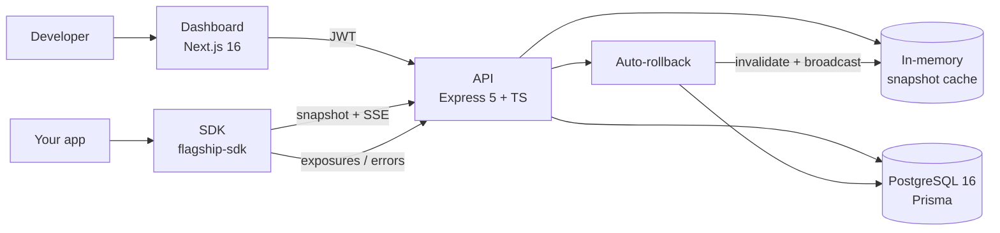

# Flagship

**A production-style feature flag platform: deterministic targeting, live updates over SSE, and automatic rollback when a release starts failing.**

[](https://github.com/Auraangel07/flagship/actions/workflows/ci.yml)


| | |
|---|---|
| Dashboard | https://flagship-one.vercel.app |
| Demo storefront (uses the SDK) | https://flagship-demo.vercel.app |
| API | https://flagship-api.onrender.com |
| API docs (Swagger) | https://flagship-api.onrender.com/docs |
| Readiness | https://flagship-api.onrender.com/ready |

> The API runs on a free Render tier and sleeps when idle. The first request can take ~50 seconds.

<!-- Add: docs/screenshots/live-flip.gif -->

## What it does

Ship code dark, turn features on per user, per percentage, per rule, and switch them off instantly without a deploy.

- **Targeting rules**: `equals`, `not_equals`, `in`, `contains` on any user attribute.
- **Percentage rollouts**: `sha256(flagKey:userKey) % 100`. The same user always gets the same answer, and raising the percentage never flips users who were already in.
- **Evaluation reasons**: every result says why: `DISABLED`, `RULE_MATCH`, `ROLLOUT`, `FALLTHROUGH`.
- **Explain endpoint**: paste a user, see exactly which rule decided.
- **Live updates**: SDKs subscribe over Server-Sent Events; a toggle reaches clients in milliseconds.
- **Auto-rollback**: SDKs report exposures and errors. With at least 20 exposures in 5 minutes and an error rate above 5%, the flag is disabled, audited, and broadcast.
- **Audit log**: before/after snapshot for every change.
- **RBAC**: `ADMIN`, `DEVELOPER`, `VIEWER`.
- **Environments**: independent config per environment, per-environment SDK keys.

## Architecture



```
flagship/
├─ apps/
│  ├─ api/         Express + Prisma + Postgres
│  ├─ dashboard/   Next.js 16, React 19, Tailwind v4, shadcn/ui, TanStack Query
│  └─ demo/        Vite + React storefront powered by the SDK
├─ packages/
│  └─ sdk/         FlagshipClient (init, isEnabled, getAll, identify, onChange, reportExposure, reportError)
└─ docker-compose.yml
```

## Quick start

Requirements: Node 20+, Docker.

```bash
git clone https://github.com/Auraangel07/flagship.git
cd flagship
npm install

# Postgres on port 5433
docker compose up -d

# API
cp apps/api/.env.example apps/api/.env      # Windows: copy apps\api\.env.example apps\api\.env
# set JWT_SECRET to a random 32+ character string
npm run db:migrate -w apps/api
npm run dev -w apps/api                     # http://localhost:4000

# Dashboard (new terminal)
npm run dev -w apps/dashboard               # http://localhost:3000

# Demo storefront (new terminal)
npm run dev -w apps/demo                    # http://localhost:5173
```

Demo env (`apps/demo/.env`):

```
VITE_API_URL=http://localhost:4000
VITE_SDK_KEY=<sdk key from the dashboard>
```

## Using the SDK

```ts
import { FlagshipClient } from "@flagship/sdk";

const client = new FlagshipClient({
  apiUrl: "https://flagship-api.onrender.com",
  sdkKey: "fs_...",
  user: { key: "user-42", plan: "pro", country: "IN" },
});

await client.init();

if (client.isEnabled("new-checkout")) {
  // new path
}

client.onChange(() => rerender());       // fires on live updates
client.reportError("new-checkout");      // feeds auto-rollback
```

## API examples

```bash
# Register / login
curl -X POST $API/auth/login -H "Content-Type: application/json" \
  -d '{"email":"you@example.com","password":"..."}'

# Evaluate all flags for a user (SDK key)
curl $API/v1/flags -H "Authorization: Bearer fs_..."

# Explain a decision
curl -X POST $API/projects/$PID/flags/$FID/explain \
  -H "Authorization: Bearer $JWT" -H "Content-Type: application/json" \
  -d '{"environment":"production","user":{"key":"u1","plan":"pro"}}'
```

Full reference: `/docs`.

## Testing

```bash
npm test                  # 37 tests: 31 API + 6 SDK
npm run lint
npm run build -w apps/demo   # the real type-check for the Vite app
```

API tests run against a real Postgres (supertest); test orgs (`@test.dev`) are removed in global teardown. CI runs lint and tests on every push with a Postgres service container.

## Production notes

helmet, CORS allowlist, rate limiting, zod-validated env, structured logs (pino, request IDs, secret redaction), central error handler, graceful shutdown, `/health` (liveness) vs `/ready` (DB check), Dockerfile, OpenAPI.

## Design decisions and tradeoffs

| Decision | Why | Tradeoff |
|---|---|---|
| **Hash bucketing** (`sha256(flag:user) % 100`) | Stateless, deterministic, no per-user storage, stable across SDKs | Distribution is statistical, not exact, on small populations |
| **SSE, not WebSockets** | Updates are one-way server to client; SSE auto-reconnects and works over plain HTTP | No client-to-server channel (exposures use normal POSTs) |
| **In-memory snapshot cache + TTL + invalidation** | Evaluation reads never hit the DB | Single-instance only. Multi-instance needs Redis pub/sub for invalidation and fan-out |
| **Cursor pagination** on audit log | Stable under inserts, index-friendly | No random page jumps |
| **Auto-rollback thresholds** (>=20 exposures / 5 min, >5% errors) | Avoids reacting to noise on tiny samples | Fixed thresholds; should be per-flag configurable |
| **Rollback is a system action** | Needs an audit trail | Currently attributed to the org's first user |

### Known limitations and roadmap

- Replace in-memory cache and SSE hub with Redis for horizontal scale.
- Compile with `tsc` for production instead of running via `tsx`.
- Paginate the flags list.
- Dedicated system actor for audit entries.
- Per-flag rollback thresholds.
- `npm audit` reports a `deepmerge-ts` advisory inside the Prisma CLI chain; build-time only, accepted.
- Free-tier hosting means cold starts.

## License

MIT